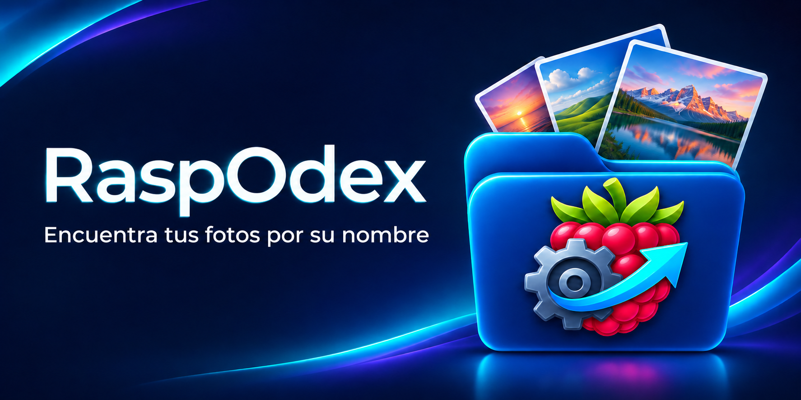
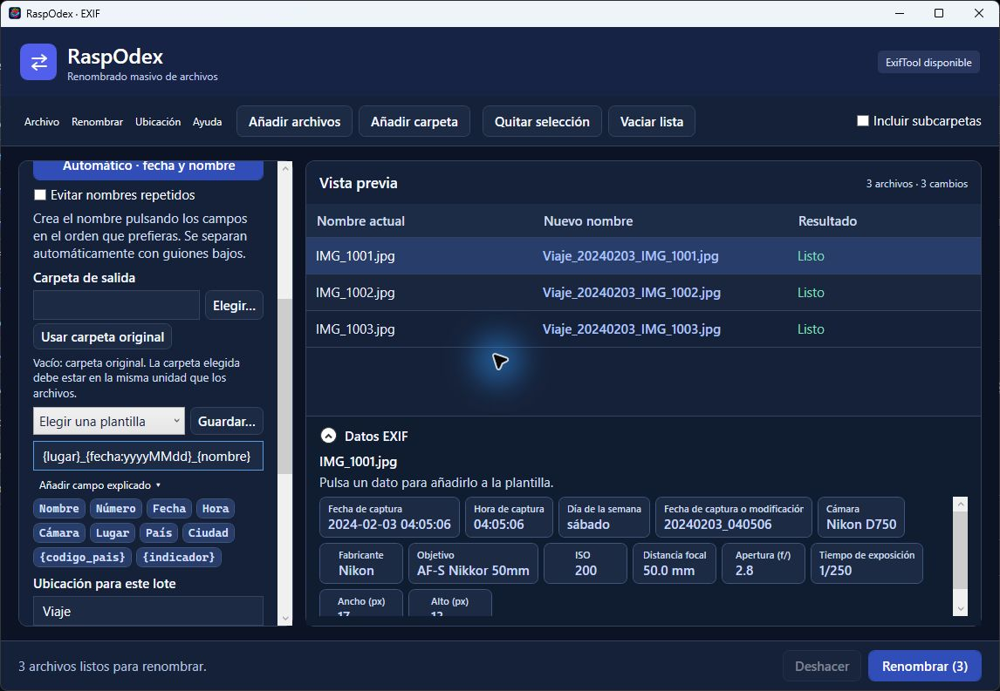

# RaspOdex



**Give your photos names that help you find them again.**

[Español](README.md) · [Download for Windows](https://github.com/Ken-2026/RaspOdex/releases/tag/v1.4.0) · [User guide in Spanish](GUIA.md)

RaspOdex is a free, open-source Windows application for renaming photos in batches. Use dates, camera metadata, a place you enter, or an approximate location derived from GPS metadata to make filenames easier to search.



*Screenshot with synthetic sample files and metadata. Review the proposed names before applying them.*

```text
IMG_1001.jpg  →  Viaje_20240203_IMG_1001.jpg
```

## Get started

1. Download **RaspOdex-1.4.0-Windows-x64-completo.zip** from the [1.4.0 release](https://github.com/Ken-2026/RaspOdex/releases/tag/v1.4.0).
2. Extract the entire ZIP to a writable folder, keeping `tools` and `data` together.
3. Run `RaspOdex.exe`; .NET, ExifTool and the offline GeoNames index are included. The interface is in Spanish.
4. Start with copies of your photos, choose a template and review the preview before renaming.

The package is large because it includes a worldwide location index. The executable is unsigned, so Windows may show a warning or block it depending on its application-control settings.

## Features and limits

- Preview batch renames using capture dates, camera details and other available EXIF data.
- Add your own place name or use offline GeoNames lookup for approximate populated places near a photo's GPS coordinates.
- Optionally choose an output folder on the same drive; this moves files rather than copying them.
- Undo the last batch during the same session if files remain available and unchanged.
- Optional online location lookup sends the selected photo's coordinates to Nominatim only after confirmation; see [privacy](PRIVACIDAD.md).

Version 1.4.0 is intended and tested for photos. It changes filenames; it does not write tags or keywords into the image. Search support depends on the gallery. Location and capture metadata may be missing or inaccurate.

Source code is licensed under [MIT](LICENSE); third-party components and data have their own terms, listed in [TERCEROS.md](TERCEROS.md).
