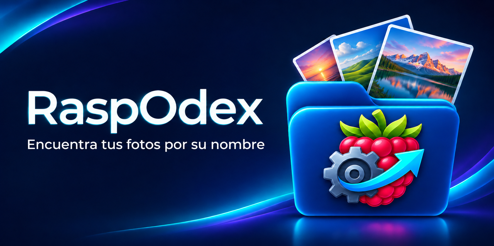
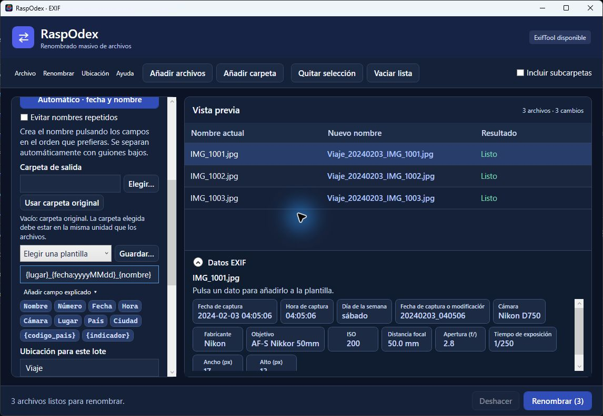

# RaspOdex



**Tus fotos tienen una historia. Dales un nombre que te ayude a encontrarlas.**

[English](README.en.md) · [Descargar para Windows](https://github.com/Ken-2026/RaspOdex/releases/tag/v1.4.0) · [Guía de uso](GUIA.md)

¿Has buscado una foto en tu galería y solo has encontrado nombres como `IMG_4812`? RaspOdex te ayuda a identificar muchas fotografías a la vez, incorporando información como el lugar y la fecha a sus nombres. Así podrás buscarlas por esas palabras en el Explorador o en una galería que permita buscar por nombre de archivo.

RaspOdex **cambia nombres de archivos**: no escribe etiquetas, palabras clave ni metadatos dentro de las fotografías. La capacidad de búsqueda depende de cada galería.

## Así se ve



*Captura de la versión 1.4.0 con archivos y datos EXIF de prueba. Los cambios se muestran antes de aplicarse.*

Por ejemplo, con el lugar elegido `Viaje` y la fecha de captura, la plantilla puede proponer:

```text
IMG_1001.jpg  →  Viaje_20240203_IMG_1001.jpg
```

## Descargar y empezar

1. Descarga el paquete completo para **Windows x64** desde [las versiones de RaspOdex](https://github.com/Ken-2026/Renombra/releases).
2. Extrae **todo el ZIP** a una carpeta donde tengas permisos de escritura. Mantén juntas sus carpetas `tools` y `data`.
3. Abre `RaspOdex.exe`. El paquete completo incluye el entorno de .NET, ExifTool y el índice local de GeoNames; no necesitas instalarlos por separado.
4. Añade unas copias de fotos para probar. Elige **Automático · fecha y nombre** o construye una plantilla y revisa la columna **Nuevo nombre**. Los archivos solo cambian cuando pulsas **Renombrar**.

El ZIP es grande porque incluye un índice mundial para usar la ubicación sin conexión. La primera apertura puede tardar. El ejecutable no está firmado digitalmente y Windows puede mostrar un aviso de aplicación desconocida.

## Una forma práctica de identificar tus fotos

Puedes combinar país, ciudad, fecha, hora y nombre original sin hacerlo foto a foto. Por ejemplo:

```text
{pais}_{ciudad}_{fecha:yyyyMMdd_HHmmss}_{nombre}
```

La aplicación intenta obtener la fecha y las coordenadas de **cada fotografía**. Si tiene GPS, puede buscar sin Internet una localidad poblada cercana; después podrás buscar el nombre de esa localidad. El resultado es aproximado y no garantiza una dirección exacta o el nombre turístico esperado. Si falta GPS o algún dato, puedes usar valores manuales y revisar los avisos en la vista previa.

## Qué ofrece

- Renombrado por lotes con vista previa, búsqueda y sustitución, mayúsculas, numeración y expresiones regulares opcionales.
- Campos seleccionables: nombre, fecha, hora, día de la semana, país, ciudad, cámara y otros datos EXIF disponibles.
- Modo automático con fecha de captura o, si falta, fecha de modificación; puede añadir un sufijo cuando hay nombres repetidos.
- Consulta local de ubicaciones mediante GeoNames y consulta en línea opcional.
- Carpeta de salida en la **misma unidad** que los archivos originales, o conservación de sus carpetas. Al elegir salida se mueven los archivos, no se copian.
- Deshacer la última tanda durante la misma sesión si los archivos siguen disponibles y no han cambiado. El historial no se conserva al cerrar.

Esta versión está orientada y probada con **fotografías**. No anunciamos compatibilidad con otros tipos de archivo hasta comprobarla. La disponibilidad de fecha, cámara y ubicación depende de los metadatos de cada foto. Cambiar una extensión no convierte el formato.

## Privacidad y uso sin conexión

La lectura EXIF, el renombrado y la búsqueda local con GeoNames se realizan en el equipo. La consulta **en línea** es opcional: al elegirla y confirmarla se envían las coordenadas de la foto seleccionada a Nominatim/OpenStreetMap. Consulta [PRIVACIDAD.md](PRIVACIDAD.md).

## Código y licencias

El código fuente está en `src/Renombra`, escrito en C# y WPF para .NET 10. Consulta [CONTRIBUTING.md](CONTRIBUTING.md) y [GUIA.md](GUIA.md). Los datos de GeoNames y las dependencias de ejecución están en el ZIP completo, no en el repositorio Git.

El código del proyecto se distribuye bajo [MIT](LICENSE). ExifTool, Strawberry Perl, .NET, SQLite y GeoNames tienen sus propias licencias y atribuciones; véase [TERCEROS.md](TERCEROS.md).
